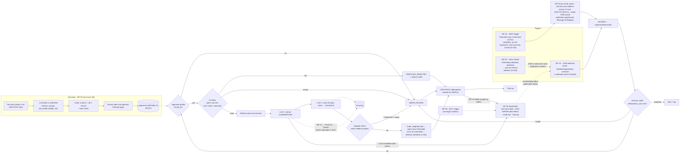

# Architecture

Adjusted from brief §3.1 for these decisions: D-007 (Gemini), D-011 (GreenMail), dedupe in the CRM, email calling WF-10 directly with the webhook suppressed, and a reconciliation sweep for webhooks n8n missed (D-033).

## Components
| ID | Component | Where | Notes |
|---|---|---|---|
| WF-00 | Hello items | `workflows/00-hello.json` | Phase 0 teaching workflow |
| WF-01 | Intake: CRM webhook | `workflows/01-intake-webhook.json` | header-auth webhook (403 on a wrong secret); responds 202 at once; normalizes; calls WF-10 |
| WF-02 | Intake: email trigger | `workflows/02-intake-email.json` | IMAP trigger (GreenMail now, Gmail later); UNSEEN with no UID bookmark across restarts, reconnect + catch-up every minute (D-034); one WF-03 execution per email, failures captured per email (D-023) |
| WF-04 | Reconcile missed webhooks | `workflows/04-reconcile-webhooks.json` | every minute: the CRM's failed `application.created` deliveries (10 per run) → `POST /webhook-deliveries/:id/redeliver` → the CRM re-sends to WF-01; WF-10's claim skips anything already screened. Successful runs aren't saved (D-033) |
| WF-03 | One email → application | `workflows/03-email-to-application.json` | parse sender and plus-address → extract PDF/TXT/DOCX text → create CRM record (no webhook, Message-ID dedupe) → normalize → WF-10 |
| WF-11 | CRM call with retry policy | `workflows/11-crm-request.json` | every CRM call goes through here: backoff on 429/5xx/timeouts, never on other 4xx (D-024) |
| WF-05 | Job profile builder | `workflows/05-job-profile-builder.json` | JD → LLM draft → checks → DRAFT |
| WF-10 | Screening pipeline | `workflows/10-screening.json` | sub-workflow: validate → dedupe → profile → pre-filter → AI → score → write-back |
| WF-12 | LLM JSON step | `workflows/12-llm-json-step.json` | Gemini `generateContent` (native schema, temp 0) with backoff, contract check, one repair; the only provider-specific workflow (D-007, D-025) |
| WF-90 | Error handler | `workflows/90-error-handler.json` | Error Trigger → WF-91, for uncaught crashes (error workflow of WF-01 and WF-02) |
| WF-91 | Dead letter | `workflows/91-dead-letter.json` | n8n Data Table `dead_letters` (works while the CRM is down) + best-effort CRM ERROR + email to ops + RunLog (D-028) |
| Replay | Dead-letter replay | `scripts/replay-dlq.js` | open rows → ERROR → `application.replay` → WF-10 reclaims ERROR→SCREENING; idempotent |
| CRM | Mock CRM | `crm/` | Node 24 + Express + `node:sqlite`; REST, webhooks with a delivery log (list failed, redeliver: D-033), pages, failure simulation |
| Proxy | LLM proxy | `llm-proxy/` · Compose service `llm-proxy` | between WF-12 and Gemini: forwards unchanged; `/admin/chaos` arms rate_limit / server_error / invalid_json / timeout for the next N calls (D-031); never logs the key |
| Eval | Evaluation tooling | `scripts/eval-smoke.js`, `failure-matrix.js`, `eval-report.js`, `role-switch-report.js` | regression smoke (5 per role), §5.4 failure-injection matrix, `reports/eval-<date>.md` |
| src | Pure logic | `src/` | inlined into Code nodes by `scripts/build-workflows.js` (drift-tested) |
| Mail | GreenMail | Compose service `greenmail` | SMTP 3025 and IMAP 3143, test only |

## Network (Docker Compose)
- Containers reach each other by service name: n8n → `http://crm:3000`, CRM → `http://n8n:5678/webhook/...`, n8n → `greenmail:3143`, n8n → `http://llm-proxy:8090` → `https://generativelanguage.googleapis.com`.
- From the host: n8n editor `http://localhost:5678`, CRM `http://localhost:3000`, llm-proxy admin `http://127.0.0.1:8090` (bound to loopback only).
