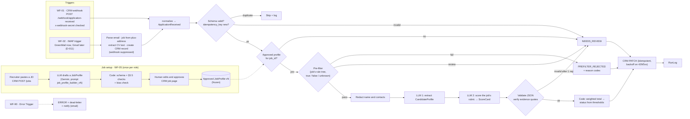

# Architecture

Adjusted from brief §3.1 for these decisions: D-007 (Gemini), D-011 (GreenMail), dedupe in the CRM, and email calling WF-10 directly with the webhook suppressed.

## Components
| ID | Component | Where | Notes |
|---|---|---|---|
| WF-00 | Hello items | `workflows/00-hello.json` | Phase 0 teaching workflow |
| WF-01 | Intake: CRM webhook | `workflows/01-intake-webhook.json` | shared-secret header; responds 202 at once, processes after |
| WF-02 | Intake: email (IMAP) | `workflows/02-intake-email.json` | GreenMail now; job from `applications+<job>@…`; CV text extraction |
| WF-05 | Job profile builder | `workflows/05-job-profile-builder.json` | JD → LLM draft → checks → DRAFT |
| WF-10 | Screening pipeline | `workflows/10-screening.json` | sub-workflow: validate → dedupe → profile → pre-filter → AI → score → write-back |
| WF-90 | Error handler | `workflows/90-error-handler.json` | Error Trigger → ERROR, dead-letter, notify |
| CRM | Mock CRM | `crm/` | Node 24 + Express + `node:sqlite`; REST, webhooks, pages, failure simulation |
| src | Pure logic | `src/` | inlined into Code nodes by `scripts/build-workflows.js` (drift-tested) |
| Mail | GreenMail | Compose service `greenmail` | SMTP 3025 and IMAP 3143, test only |

## Network (Docker Compose)
- Containers reach each other by service name: n8n → `http://crm:3000`, CRM → `http://n8n:5678/webhook/...`, n8n → `greenmail:3143`.
- From the host: n8n editor `http://localhost:5678`, CRM `http://localhost:3000`.
