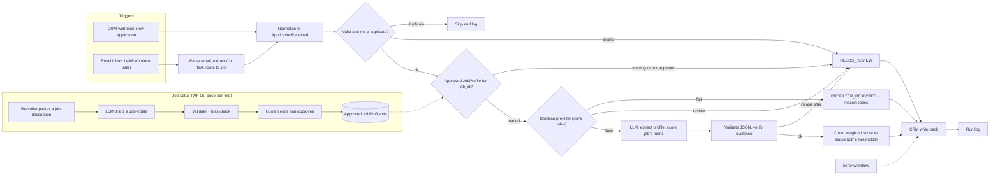

# Project Brief — Auto-Score Applicants (n8n + AI)

> Written for Claude Code. `CLAUDE.md` holds the working rules; this file holds the plan.
> Read §0 first.

## 0. How to use this brief
- At the start of each session, read only the §7 section for the current phase (see `docs/PROGRESS.md`). Don't re-read the whole brief every session.
- Phase 0 begins by recording the decisions already made in §4, then asking the questions that are still open. Record each answer as a decision and mark it in §4 as `✔ D-###`.
- The defaults below are recommendations, not commitments. When the learner chooses differently, adapt the plan and log the change.
- Time estimates assume about 4 focused hours a day. Re-plan them in Phase 0 from the learner's real pace and target date.

## 1. Mission and success criteria
Build a portfolio-grade replica of a real freelance job: an n8n + AI workflow that screens applicants, scores them and assigns CRM statuses "correctly every time", for **whatever role the recruiter sets up**, while teaching the learner automation from scratch.

The project is done when:
1. **It runs end to end:** an application arrives → Boolean pre-filter → AI scoring against the job's profile → the CRM is updated with score, breakdown, rationale and status.
2. **It adapts to the role:** a new role is added by pasting a job description into the CRM, a human approves the AI-drafted profile, and candidates for that role are screened with no code changes.
3. **It is proven on ~250 synthetic applicants across three roles:** the pre-filter matches the answer key 100%; AI status agreement with the answer key, run-to-run consistency and the role-switch test are measured and reported; failure-injection tests pass with no lost records.
4. **It is documented as it went:** every non-trivial choice is in DECISIONS, every mistake in LESSONS, every concept in LEARNING.
5. **The learner owns it:** they can give a 10-minute walkthrough and answer interview questions about every component without help.

## 2. The original scope (client job post)
> We are looking for an experienced n8n / AI Automation Engineer to help us create automation workflow that is working inside our CRM website, screening candidates' applications, scoring them and assigning appropriate statuses. We need someone who can build the AI automation workflow so it works correctly every time.
>
> **You will:** create trigger setup · make the Boolean pre-filter · build AI-powered screening of candidates profiles and scoring logic · ensure proper integration between AI automation and CRM website.
>
> **Required:** hands-on n8n (or other workflow automation tools like Zapier, Microsoft Power Automate) · strong JSON and data mapping skills · experience designing and sticking to a stable schema/contract between workflow steps · good JavaScript (preferably within n8n Code nodes) · AI / LLM workflow experience · validation, testing and error-handling mindset · experience with Outlook APIs or IMAP.
>
> **Nice to have:** AI agents / AI nodes inside n8n · building automations for recruitment, HR or job processing.

This post describes the client's needs, not the role being screened. The system screens applicants for the client's own open roles (§3.2). Every requirement maps to evidence in the finished repo (see the map at the end of §7).

## 3. What we're building

### 3.1 Flow


### 3.2 Jobs: one engine, many job profiles
The scoring engine knows nothing about any particular job. Everything that makes a role different lives in a **JobProfile**: its must-haves (pre-filter rules), rubric criteria with weights and 0–4 anchors, nice-to-haves and status thresholds. Each application belongs to one job, and screening loads that job's approved profile. Changing the role changes the profile, never the code.

- **Starting roles** are hand-written in Phase 1, so the engine is generic from day one:
  - **Customer Service Representative** (`csr`, the default). Businesses hire for this role constantly and in high volume, which is exactly where automated screening pays off.
  - **Sales Development Representative** (`sdr`). Its signals are different (prospecting and quota results instead of support experience), which proves the engine isn't secretly tuned to one job.
- **New roles from a job description** (Phase 7): a recruiter pastes a job description into the CRM. An LLM drafts a JobProfile from it, code validates the draft and checks it for bias, and a human edits and approves it. Only then can candidates be scored against it.
- **Frozen versions:** an approved version never changes, so every candidate for that version is scored against exactly the same rubric. Editing creates a new version. Every score records `job_id` and `job_profile_version`, so you can always answer "which rubric scored this person?"
- **The AI reads the job description once, to draft the profile, never per candidate.** After approval, the profile is the contract. Re-reading the JD for every candidate would make scores inconsistent and impossible to audit.

### 3.3 Components
| ID | Component | Notes |
|---|---|---|
| WF-01 | Intake: CRM webhook | shared-secret header check; respond fast, process after |
| WF-02 | Intake: email | IMAP trigger (Outlook as a stretch goal); attachment → text; routes each email to a job |
| WF-05 | Job profile builder | job description → LLM draft → validate + bias check → saved as a draft for human approval |
| WF-10 | Screening pipeline (sub-workflow) | validate → dedupe → load job profile → pre-filter → AI → score → write-back |
| WF-90 | Error handler | n8n Error Trigger → mark record, dead-letter, notify |
| `crm/` | Mock CRM | jobs with versioned profiles, candidates per job, REST API, webhooks, HTML pages, failure simulation |
| `src/` | Pure JS logic | normalize, prefilter, scoring, validate, evidence check, job-profile checks; unit tested |
| `scripts/` | Tooling | data generator, CRM seeder, workflow export/import, eval runner, dead-letter replay |

### 3.4 Contracts (Phase 1 designs them; these are starting points)
- **JobProfile**: job_id, version, status (`draft`, `approved`, `archived`), title, source_jd_text, prefilter (rule tree, §5.1), criteria[] {id, name, weight, anchors 0–4, evidence_hints, jd_quote}, nice_to_haves[], thresholds {shortlist, maybe}, bias_flags[], created_by (`human` or `llm_draft`), approved_by, approved_at, schema_version
- **ApplicationReceived**: application_id, source (`crm` or `email`), received_at, job_id, candidate {…}, answers {…} (application-form questions such as shift availability; may be missing for email applicants), cv {text, filename, mime, sha256, extraction_method}, idempotency_key, schema_version
- **PrefilterResult**: outcome (`pass`, `fail`, `review`), reason_codes[], job_profile_version
- **CandidateProfile** (LLM extraction): experience[], skills[], tools[], achievements[], each with an evidence quote
- **ScoreCard**: per criterion (ids from the JobProfile) a 0–4 score, evidence quote and rationale; overall_confidence; flags[]
- **CrmUpdate**: status, total_score (0–100), breakdown, summary, reason_codes, job_id, job_profile_version, prompt_version, model, execution_id, processed_at
- **RunLog**: execution_id, application_id, job_id, stage timings, tokens, cost estimate, outcome, error

### 3.5 State machines
Candidate status:
```
NEW ──► SCREENING ──► SHORTLISTED | MAYBE | NOT_A_FIT | NEEDS_REVIEW
 │          │
 │          └──► ERROR ──(replay)──► SCREENING
 └──► PREFILTER_REJECTED
```
Job profile:
```
DRAFT ──(human approves)──► APPROVED vN ──► ARCHIVED
                               │
                               └──(edit)──► new DRAFT vN+1
```
Only these transitions are allowed, and the CRM rejects any other (that gets a test). AI outcomes are recommendations; a human owns the final hiring decision.

### 3.6 Repo layout
```
.
├── CLAUDE.md
├── README.md                 # Phase 9 case study
├── docker-compose.yml        # n8n + crm
├── .env.example
├── .claude/skills/           # start-session, wrap-up, concept (§9)
├── docs/                     # PROJECT_BRIEF, PROGRESS, DECISIONS, LESSONS, LEARNING, ARCHITECTURE, INTERVIEW_PREP
├── contracts/                # *.schema.json and fixtures/
├── config/jobs/              # seed JobProfiles: csr.v1.json, sdr.v1.json
├── prompts/                  # screening_v1.md, job_profile_builder_v1.md, …
├── src/                      # pure JS logic used by Code nodes
├── tests/                    # unit and contract tests
├── workflows/                # exported n8n workflow JSON
├── crm/                      # mock CRM service
├── data/                     # synthetic applicants, CV files, job descriptions, ground_truth.csv
├── scripts/                  # generate, seed, export/import, eval, replay
└── reports/                  # eval and failure-injection results
```

## 4. Decisions and open questions (Phase 0)

### Already decided by the learner: record these as D-001 to D-005 in Phase 0
| ID | Topic | Decision | Notes |
|---|---|---|---|
| D-001 ✔ | Project type | Portfolio replica: a mock CRM (§5.3) and synthetic applicants (§6) | No real applicant data anywhere |
| D-002 ✖ superseded by D-007 | LLM provider | ~~Anthropic Claude API~~ → Gemini API free tier (D-007) | Use a small, low-cost model for bulk scoring. Check current model names, limits and the n8n node in the docs before choosing |
| D-003 ✔ (staged by D-011) | Email intake | Gmail via IMAP on a dedicated test account with an app password; local GreenMail first (D-011) | Outlook via Microsoft Graph stays a Phase 9 stretch goal |
| D-004 ✔ | Working style | Claude builds; the learner reviews | See "Review mode" in CLAUDE.md. The learner still makes design decisions and enters their own credentials. D-008 defers the review loop |
| D-005 ✔ | Roles | Role-agnostic engine driven by versioned JobProfiles (§3.2). Customer Service Representative is the default role, Sales Development Representative the second; any further role is added from a job description in Phase 7 (Administrative Assistant, D-012) | Human approval is required before a profile is used |

### Open questions: answered 2026-10-17
| # | Question | Answer | Record |
|---|---|---|---|
| 1 | Environment: OS, Docker installed, Node version, Git/GitHub set up? | Windows 11, Docker 29.5 + Compose v5.1, Node 24.13, git + gh. Self-hosted n8n in Docker Compose | ✔ D-006 |
| 2 | Is the Anthropic API key ready? What spending cap for this project? | Use the Gemini free tier for now ($0); the LLM call stays swappable | ✔ D-007 |
| 3 | Pace: hours per day and target finish date? | Build straight through now; lessons deferred to a review pass | ✔ D-008 |
| 4 | Public GitHub repo for the portfolio? | Yes, public from day one | ✔ D-009 |
| 5 | How you read and write n8n workflows | n8n public REST API + export/import scripts | ✔ D-010 |
| — | Rubric weights and thresholds | Brief §5.2 defaults; 75 / 55 | ✔ D-013 |

## 5. Design guidance

### 5.1 Boolean pre-filter
- **Purpose:** a cheap, deterministic, explainable gate, so the LLM only sees plausible candidates. Every rejection carries a reason code.
- **Rules are data**, stored in each JobProfile's `prefilter` field: a JSON tree of `all` / `any` / `not` with leaf checks. The supported checks form a fixed registry in `src/prefilter.js`: `cv_text_min_chars`, `keyword`, `field_present`, `field_equals`, `field_includes`, `number_gte`, `duplicate`. A profile (including an AI-drafted one) may only use checks from this registry.
- **Starting point for `csr`:**
  ```json
  { "all": [
    { "check": "cv_text_min_chars", "value": 300 },
    { "check": "field_equals", "field": "answers.shift_availability", "value": "yes" },
    { "check": "field_includes", "field": "answers.languages", "value": "English" },
    { "any": [
      { "check": "keyword", "terms": ["customer service", "customer support", "call center", "contact center", "help desk"] },
      { "check": "keyword", "terms": ["retail", "front desk", "hospitality", "cashier"] }
    ]},
    { "not": { "check": "duplicate" } }
  ]}
  ```
  For a truly entry-level opening a recruiter might drop the experience branch. That's a per-job decision, which is exactly why rules live in the profile and not in code.
- **Keyword matching:** case-insensitive, word boundaries, synonym lists. Be explicit about its limit: it cannot tell "handled 60 calls a day" from "hoping to work in customer service someday". That is why AI screening comes next.
- **Three outcomes:** `pass`; `fail` (a clear miss); `review` (suspicious or incomplete: injection-like phrases, unreadable CV, missing form answers from an email applicant).

### 5.2 AI screening and scoring
- **One call or two?** Decide in Phase 5. Default: two (extract the profile, then score it), which is easier to debug and evaluate, at a higher cost.
- **How to call the model?** n8n AI nodes (for example an LLM chain with a structured output parser) versus an HTTP Request node to the provider's API. Default: learn the n8n AI nodes first (the job post lists them as a plus) and keep the HTTP route as a fallback. Check current node names in the n8n docs.
- **The screening prompt is role-agnostic.** Criteria, anchors and evidence hints are injected from the JobProfile. If a role-specific word such as "customer" or "quota" appears in the prompt template itself, that's a bug.
- **Starting rubrics** (the learner refines weights and anchors):

  `csr` — Customer Service Representative
  | Criterion | Weight |
  |---|---|
  | Customer-facing experience (support, call center, retail, hospitality) | 25 |
  | Problem solving and de-escalation | 20 |
  | Written communication (email, chat, tickets) | 15 |
  | Results evidence (CSAT, handle time, first-contact resolution, QA scores) | 15 |
  | Support tools (ticketing systems, CRMs) | 15 |
  | Product or industry familiarity | 10 |

  `sdr` — Sales Development Representative
  | Criterion | Weight |
  |---|---|
  | Outbound prospecting (cold calls, emails, social selling) | 25 |
  | Quota or target attainment, with numbers | 20 |
  | Lead research and qualification | 15 |
  | Objection handling and communication | 15 |
  | Sales tools (CRM, sales engagement platforms) | 15 |
  | B2B or industry knowledge | 10 |

  Each criterion gets a 0–4 score with written anchors (0 = no evidence … 4 = sustained, specific, measurable evidence). Code computes `total = Σ weight × score / 4`. Nice-to-haves become flags or a small bonus (decide).
- **Thresholds** live in each profile. Starting point for both roles: ≥ 75 SHORTLISTED · 55–74 MAYBE · < 55 NOT_A_FIT. Low confidence, a validation failure or a flag → NEEDS_REVIEW.
- **Evidence check in code:** every quote must appear in the CV text (after normalizing whitespace and case). Decide what an unverified quote does: zero that criterion, or send the record to review.
- **Redaction:** decide whether to strip name, contact details and addresses before the LLM sees the CV. Either way, add a counterfactual test: the same CV under a different name must get the same score.
- **Prompt injection:** the CV goes inside clear delimiters, the system prompt says it is data, the pre-filter flags phrases like "ignore previous instructions", and the dataset contains an injection test CV.

### 5.3 CRM integration
- **Mock CRM default spec:** Node.js + SQLite.
  - Jobs: `GET /jobs`, `GET /jobs/:id` (current approved version), `GET /jobs/:id/versions/:v`, `POST /jobs` (create a draft from a pasted job description; fires a webhook to WF-05), `PATCH /jobs/:id/draft` (edit the draft), `POST /jobs/:id/approve` (freeze it as a new version).
  - Candidates: `POST /applications` (creates a candidate for a job with status NEW and fires a webhook to WF-01), `GET /candidates?job_id=&status=`, `GET /candidates/:id`, `PATCH /candidates/:id` (enforces allowed transitions).
  - Auth via an `x-api-key` header. Env flags `FAIL_RATE` and `LATENCY_MS` simulate failures.
  - Pages: a candidate list with a job selector, status badges, score and an expandable breakdown; a job page to paste a job description, review the AI draft (each criterion next to its JD quote and any bias flags), edit and approve.
- The CRM is not the learning focus. Write it quickly, but propose the status model and API contract to the learner as a decision and walk them through it.
- **Write-back:** idempotent PATCH; exponential backoff retries on 429, 5xx and timeouts, never on other 4xx; explicit timeouts on every call.

### 5.4 Reliability checklist (Phase 8 proves each row)
- The same application delivered twice → processed once
- CRM down or slow → retried, then ERROR + dead-letter entry, replayable later
- LLM returns invalid JSON, times out or hits a rate limit → repair retry or backoff, then NEEDS_REVIEW
- Missing attachment, scanned PDF with no text layer, DOCX, very long CV, non-English CV, empty email body
- Email applicant with no application-form answers → `review`, not `fail`
- Prompt injection inside a CV
- Name-swap counterfactual: same CV, different name → same score
- Application for an unknown or not-yet-approved job → NEEDS_REVIEW with reason `JOB_NOT_APPROVED`, never scored against a guess
- Role switch: the same CVs scored against `csr` and `sdr` → different, sensible results (support-heavy CVs rank higher for `csr`, prospecting-heavy CVs for `sdr`)
- Biased job description → bias flags shown on the draft, and approval blocked until a human resolves them
- Records in = records out across the full dataset

### 5.5 Job profile builder (WF-05)
- **Input:** a job title and the pasted job description. **Output:** a JobProfile draft that validates against the schema.
- **Code checks after the LLM** (`src/jobprofile.js`): weights sum to 100; 4–8 criteria; every criterion has all five anchors; the pre-filter uses only registry checks (§5.1); every criterion and must-have cites a quote that actually appears in the JD (the same evidence check as for CVs); thresholds are present. A draft that fails gets one repair retry, then is saved with errors shown, never silently fixed.
- **Bias check:** flag (don't silently drop) criteria or rules that mention or stand in for protected attributes, for example age words ("young", "digital native"), gendered words, "native speaker" (as opposed to a legitimate "fluent in"), photos, marital status, or nationality. A genuine legal work requirement belongs in a yes/no form question, not the rubric. Some phrases, such as "recent graduate" for a graduate program, can be legitimate, so flags go to the human; they aren't automatic rejections.
- **Human approval is required.** The job page shows each criterion next to its JD quote, plus any flags.
- **Consistency:** draft from the same JD three times and compare the criteria. Large swings mean the builder prompt needs work, but human approval is what guarantees consistency.

## 6. Test data
- `scripts/generate_applicants.js`, seeded so it's reproducible, producing ~250 fictional applicants: ~110 for `csr`, ~110 for `sdr`, and ~30 for the role added in Phase 7 (generated after its profile is approved). Mix per role: ~30% strong, ~30% medium, ~30% weak, ~10% edge cases from §5.4.
- **Cross-applicants:** ~15 candidates whose background fits the other role (for example a sales CV applying for `csr`).
- **Role-switch set:** 20 CVs scored against both `csr` and `sdr`, with the expected direction recorded for each.
- **Job descriptions** in `data/jobs/`: the JD for the Phase 7 role, plus one deliberately biased JD for the bias-check test.
- Formats: mostly `.txt` and text PDFs, some `.docx`, a few image-only PDFs.
- Answer key `data/ground_truth.csv`: job_id, the expected pre-filter outcome (exact), the expected status band (for the AI eval) and the trait each persona was built to test.
- Generation is template-based by default (free and deterministic). Optionally, LLM-written CVs for a small realism subset; decide and log it.

## 7. Phase roadmap
Every phase lists: Goal · Concepts · Build · Learner's part · Done when. You do the building (D-004). The learner's part is what they decide, review, predict or explain. Every phase ends with the **phase checkpoint**:
1. Three interview-style questions on the phase. The learner answers, you give feedback, and LEARNING is updated.
2. A three-line retro: keep / change / try. "Change" items about how we work become Learned Rules.
3. Update PROGRESS, commit, tag `phase-N`.

### Phase 0 — Orientation and setup (≈ 0.5 day)
**Goal:** the environment runs, the docs exist, and the learner holds the big picture.
**Concepts:** C-01, C-02, C-03 (preview only).
**Build:**
1. Record D-001 to D-005 from §4. Ask the open §4 questions in one batch, record the answers from D-006 on, and update §4.
2. `git init`; create the §3.6 layout, `.gitignore` (at least `.env` and local data outputs), `.env.example`, the docs from the §8 templates and the skills from §9. Fill PROGRESS with planned dates based on the learner's pace.
3. `docker-compose.yml` with n8n and a persistent volume, following current n8n docs. Confirm the editor loads. Set up the workflow sync method from §4 question 5.
4. `docs/ARCHITECTURE.md`: the §3.1 diagram adjusted to the decisions. Walk the learner through it end to end in plain words (Concept Break C-01).
5. **"Hello items" workflow:** build a Manual Trigger → a Code node returning 3 items → a node that adds a field with an expression → an IF or Filter node. Export it to `workflows/00-hello.json`.

**Learner's part:** predict the item count at each node of "hello items", then run it in the editor and inspect the execution data (Concept Break C-02); walk through the architecture diagram.
**Done when:** n8n runs from Compose; the learner ran the hello workflow and predicted the item flow correctly; all docs exist; first commit made; tagged `phase-0`.

### Phase 1 — Contracts and job profiles (≈ 1 day)
**Goal:** design every data shape that crosses a step boundary, and express each role's requirements as data, before building any real nodes.
**Concepts:** C-04, C-05, C-06, C-32 (introduced).
**Build:**
1. Concept Break C-05 first. Then draft the JobProfile and ScoreCard schemas and run the review routine on them.
2. `contracts/*.schema.json` (JSON Schema 2020-12) for the seven contracts in §3.4, each with `schema_version`, plus valid and invalid fixtures in `contracts/fixtures/`.
3. `src/validate.js` (for example with Ajv) and tests that every fixture passes or fails as expected.
4. `config/jobs/csr.v1.json` and `config/jobs/sdr.v1.json`: rubric (weights and 0–4 anchors per criterion), thresholds and pre-filter rules (§5.1, §5.2). The learner sets weights and thresholds; record them as a D-###.
5. Show, in the hello workflow, how an n8n expression maps a field from one contract into the next (C-04).

**Learner's part:** decide the weights and thresholds for both roles; review the ScoreCard schema and find one field that's missing or too loose before you point anything out; explain why we hand-write *two* profiles now instead of one.
**Done when:** schemas, fixtures and passing tests exist; both job profiles validate against the JobProfile schema; C-05 is at `can-explain`.

### Phase 2 — Mock CRM and synthetic applicants (≈ 1.5 days)
**Goal:** something realistic to integrate with, and enough data to test at scale.
**Concepts:** C-07, C-08, C-22 (introduced while designing the status models).
**Build:**
1. Propose the candidate and job-profile state machines (start from §3.5) and the API contract. The learner decides. Then write the CRM (§5.3), with the jobs table seeded from `config/jobs/`. The job-description builder page can be a placeholder until Phase 7.
2. Add `crm` to Docker Compose and document its API in `crm/README.md`. Verify that n8n reaches the CRM by service name.
3. `scripts/generate_applicants.js` per §6 (the `csr` and `sdr` applicants for now), and `scripts/seed_crm.js` to load them as NEW. Bulk seeding must not fire 220 webhooks at once; give it a flag.
4. `data/ground_truth.csv` with job_id, the expected pre-filter outcome and the status band per applicant.

**Learner's part:** decide the state machines and API contract; spot-check 10 rows of the answer key.
**Done when:** the CRM page shows ~220 NEW candidates, filterable by job; a test proves the API rejects illegal transitions for candidates and job profiles; the answer key exists and has been spot-checked.

### Phase 3 — Triggers and intake (≈ 2 days)
**Goal:** two different entry points produce identical, valid ApplicationReceived objects, routed to the right job, exactly once.
**Concepts:** C-03 (in depth: webhook versus polling, at-least-once delivery), C-09, C-10, C-11.
**Build:**
1. **WF-01:** Webhook node with a shared-secret header check → normalize (`src/normalize.js`) → validate → call WF-10 (for now a stub that only logs).
2. **WF-02:** IMAP email trigger on the test mailbox → parse sender, subject and body → work out the job (default: Gmail plus-addressing such as `inbox+csr@…`, or a job code in the subject; decide) → extract the CV text from the attachment → create the CRM record → normalize → validate → WF-10. An email that can't be matched to a job goes to NEEDS_REVIEW. Check which file formats n8n's file-extraction node supports today; DOCX may need another route. Scanned PDFs with no text layer go to NEEDS_REVIEW (OCR is out of scope unless decided otherwise).
3. **Idempotency:** compute `idempotency_key`; check for duplicates (in a CRM field or a small store, decide which); log and skip duplicates.
4. Decide (D-###) how email intake and the CRM webhook avoid processing the same applicant twice, since creating the CRM record also fires the webhook.
5. `scripts/send_test_email.js` sends a handful of test applications. Bulk testing goes through the webhook path, not hundreds of emails.

**Learner's part:** enter the Gmail app password into the n8n credential themselves; review the normalize mapping and predict what breaks if the email has no attachment.
**Done when:** one email application and one CRM application reach WF-10 as schema-valid objects of the same shape with the right job_id; sending the same email twice and firing the same webhook twice each produce exactly one run; normalize tests pass.

### Phase 4 — Boolean pre-filter (≈ 1 day)
**Goal:** a deterministic, explainable gate in front of the LLM, driven by each job's rules.
**Concepts:** C-12, C-13, C-14.
**Build:**
1. `src/prefilter.js`: the check registry and a pure `evaluate(application, rules)` returning a PrefilterResult with reason codes, implementing the §5.1 rule tree. An unknown check name throws; it is never ignored.
2. Tests: truth-table cases for `all` / `any` / `not`; keyword edge cases (case, punctuation, plurals, substrings such as "retail" inside "retailer" or "sales" inside "wholesales"); missing form answers → `review`; injection-phrase flags; the same applicant evaluated against both job profiles.
3. Wire it into WF-10 with a Code node and Switch/IF routing, loading the rules from the job's approved profile: `fail` → CRM PREFILTER_REJECTED with reason codes; `review` → NEEDS_REVIEW; `pass` → AI stub.

**Learner's part:** decide the rule sets; review the truth-table tests and suggest at least one edge case you didn't cover.
**Done when:** the pre-filter matches the answer key on 100% of the dataset for both roles; a count shows zero LLM calls for rejected applicants; C-13 is at `can-explain`.

### Phase 5 — AI screening and scoring (≈ 3 days)
**Goal:** reliable, explainable LLM scoring that adapts to the job's rubric and always fits the contract.
**Concepts:** C-15, C-16, C-17, C-18, C-19, C-20, C-21.
**Build:**
1. Decide one call versus two, and n8n AI node versus HTTP Request (§5.2). Record both.
2. `prompts/screening_v1.md`: a role-agnostic system prompt and user template, CV inside delimiters, criteria and anchors injected from the job profile.
3. LLM call(s) with structured output → validate against CandidateProfile and ScoreCard (criterion ids must match the job profile exactly) → one repair retry → otherwise NEEDS_REVIEW.
4. `src/evidence.js`: verify each quote appears in the CV text; handle unverified quotes per the §5.2 decision.
5. `src/scoring.js`: weighted total and status mapping from the profile's thresholds, unit tested at the boundaries (54.9, 55, 74.9, 75) and with both profiles.
6. Redaction step (if decided) and the name-swap counterfactual test.
7. Run on 5 records per role and review the results together, then on 20 per role. Log tokens and cost per record. Then run a first small role-switch check (5 CVs against both roles).

**Learner's part:** approve the rubric anchors; after reviewing the 20-record results, name the main failure pattern and the hypothesis prompt v2 should test (you write v2).
**Done when:** on 20 records per role, outputs are 100% schema-valid after repair; the evidence check is active; status mapping tests pass; the injection test CV doesn't change its own score; the prompt template contains no role-specific words; cost per record is recorded.

### Phase 6 — CRM write-back and error handling (≈ 2 days)
**Goal:** results land in the CRM safely, and failures are visible and recoverable.
**Concepts:** C-22 (in depth), C-23, C-24, C-25.
**Build:**
1. PATCH the CRM with a CrmUpdate (fields in §3.4, including `job_profile_version`): idempotent, transitions enforced.
2. Retries: exponential backoff on 429, 5xx and timeouts; none on other 4xx; explicit timeouts.
3. **WF-90** error workflow (n8n Error Trigger): mark the record ERROR, write a dead-letter entry (payload, error, execution ID), notify (decide the channel).
4. `scripts/replay_dlq.js`: re-run dead-lettered records safely (idempotent).
5. Write a RunLog per execution.
6. Make the NEEDS_REVIEW queue visible on the CRM page.

**Learner's part:** review WF-90 and the retry settings; predict the outcome of the `FAIL_RATE=0.3` run before it happens.
**Done when:** with CRM `FAIL_RATE=0.3` on 50 records, every record ends in a final status or ERROR, records in = records out, and replay moves every ERROR record to a final status.

### Phase 7 — Add any role from a job description (≈ 2 days)
**Goal:** a recruiter adds a new role by pasting a job description, a human approves the AI-drafted profile, and screening adapts with no code changes.
**Concepts:** C-32 (in depth), C-33, C-20 (revisited: bias can enter through the JD), C-21 (revisited: profile versions).
**Build:**
1. **WF-05:** CRM `POST /jobs` webhook → `prompts/job_profile_builder_v1.md` → LLM drafts a JobProfile → schema validation and the §5.5 code checks → bias check → save as DRAFT with any errors and flags.
2. Finish the CRM job page: paste a JD, review the draft (criteria beside their JD quotes, flags highlighted), edit, approve. Approving freezes the version; editing an approved profile creates a new draft version.
3. Enforce in WF-10: an application for a job with no approved profile → NEEDS_REVIEW with `JOB_NOT_APPROVED`.
4. Re-scoring: when a new version is approved, existing scores keep their old version reference. Add an optional bulk re-score (ask first, with a cost estimate).
5. **The demo:** the learner picks a third role (for example Bookkeeper, Administrative Assistant or Warehouse Associate) and writes or finds a realistic JD for it. Run the builder, approve the profile, generate ~30 applicants for it and screen them. Show with `git diff` that nothing under `src/`, `prompts/screening_*` or `workflows/` changed.
6. Tests: the planted biased JD gets flagged; malformed drafts are rejected (weights summing to 90, an unregistered check, a criterion quote not found in the JD); builder consistency over three drafts of the same JD; the full role-switch set (§6).

**Learner's part:** choose the third role and its JD; review the AI draft and decide what to change before approving; explain why an approved profile must be frozen (C-33 at `can-explain`).
**Done when:** the third role works end to end with no code changes; every score records its `job_profile_version`; the biased JD is flagged and can't be approved without a human resolving the flags; the role-switch set moves in the expected direction for at least 18 of 20 CVs (or the gap is explained in LESSONS).

### Phase 8 — Prove it works every time (≈ 2 days)
**Goal:** evidence instead of belief.
**Concepts:** C-26, C-27, C-28, C-29.
**Build:**
1. A full-dataset run across all three roles (ask first, with a cost estimate), batched to respect rate limits.
2. `reports/eval-<date>.md`, per role and overall: pre-filter agreement; a status confusion matrix against the answer key; consistency (score spread across 3 runs of the same 20 CVs); the role-switch results; latency and cost per record; NEEDS_REVIEW rate.
3. A failure-injection matrix covering every §5.4 row: expected, actual, pass or fail.
4. Fix what fails, re-run, and compare prompt v1 with v2 in the report.
5. `npm test` (unit and contract tests) and `npm run eval:smoke` (5 records per role, end to end) as the regression check.

**Learner's part:** read the confusion matrices and explain the biggest error pattern before you do.
**Done when:** the report contains real numbers; every §5.4 row passes or is documented as a known limitation; both regression commands pass.

### Phase 9 — Package for portfolio and interviews (≈ 1.5 days)
**Goal:** the learner can show and defend the work.
**Concepts:** C-30, C-31.
**Build:**
1. `README.md` as a case study: the problem, architecture diagram, how one record flows, how a new role is added, key decisions (linking D-###), results (linking the report), limitations, what's next.
2. A 3-minute demo script whose centerpiece is adding a role live: paste a JD → approve the profile → applicants scored. Include before/after screenshots of the CRM.
3. `docs/INTERVIEW_PREP.md`: 15 questions an interviewer would ask about this system. The learner writes the answers; you critique them.
4. Secrets audit; `.env.example` complete; a fresh clone runs using only the README.

**Learner's part:** write the interview-prep answers; rehearse the demo; do the fresh-clone run themselves.
**Stretch (pick any):** an Outlook trigger via Microsoft Graph feeding the same contract (proves the adapter design); an AI Agent node variant; a notification on SHORTLISTED; an auto-reply asking email applicants for missing form answers.
**Done when:** the learner gives a 10-minute unaided walkthrough; every concept in LEARNING is ✅ or consciously ⏭; a fresh clone runs.

### Job post → evidence map
| Requirement | Where the repo proves it |
|---|---|
| Hands-on n8n | `workflows/`, Phases 0–7 |
| JSON and data mapping | `contracts/`, normalization in WF-01 and WF-02 |
| Stable schema/contract between steps | `contracts/`, boundary validation, contract tests, versioned JobProfiles |
| JavaScript in Code nodes | `src/` with tests, Code nodes in WF-05 and WF-10 |
| AI / LLM workflow | Phases 5 and 7, `prompts/`, eval report |
| Validation, testing, error handling | Phases 6 and 8, `reports/` |
| Outlook APIs or IMAP | WF-02 (plus the Outlook stretch goal) |
| Nice to have: AI nodes in n8n | Phases 5 and 7 |
| Nice to have: recruitment automation | the whole project |

## 8. Doc templates (Phase 0 creates these files)

### `docs/PROGRESS.md`
```markdown
# Progress
**Current phase:** 0 — Orientation and setup · **Target finish:** <date> · **Pace:** <hours/day>

## Now / Next / Blocked
- **Now:**
- **Next:**
- **Blocked:**

## Phases
| # | Phase | Status | Planned | Done | Tag |
|---|---|---|---|---|---|
| 0 | Orientation and setup | ⬜ | | | |
| 1 | Contracts and job profiles | ⬜ | | | |
| 2 | Mock CRM and synthetic applicants | ⬜ | | | |
| 3 | Triggers and intake | ⬜ | | | |
| 4 | Boolean pre-filter | ⬜ | | | |
| 5 | AI screening and scoring | ⬜ | | | |
| 6 | CRM write-back and error handling | ⬜ | | | |
| 7 | Add any role from a job description | ⬜ | | | |
| 8 | Prove it works every time | ⬜ | | | |
| 9 | Package for portfolio and interviews | ⬜ | | | |
Status: ⬜ not started · 🟨 in progress · ✅ done (all "Done when" items met, with evidence)

## Current phase checklist
- [ ] (copy the phase's "Done when" items from the brief)

## Session log (newest first)
### S-01 · YYYY-MM-DD
- Done:
- Verified (evidence):
- Not yet verified:
- Concepts: C-##
- Decisions: D-###
- Lessons: L-###
- Next:
```

### `docs/DECISIONS.md`
```markdown
# Decisions
## D-### · <title>
- **Date:** · **Phase:** · **Status:** accepted | superseded by D-###
- **Decided by:** learner | Claude | together (Claude recommended: …)
- **Context:** what forced a choice
- **Options:** A — … (+ … / − …) · B — … · C — …
- **Decision:**
- **Why:**
- **Trade-offs accepted:**
- **Revisit if:**
```

### `docs/LESSONS.md`
```markdown
# Lessons
## L-### · <short title>
- **Date:** · **Phase:** · **Who:** Claude | learner
- **What happened:**
- **Symptom:** how we noticed
- **Root cause:**
- **Fix:** and how it was verified
- **Prevention rule:** → promoted to Learned Rules? yes / no
- **Concept it illustrates:** C-##
```

### `docs/LEARNING.md`
```markdown
# Learning tracker
Status: ⬜ not yet · 🟦 introduced · 🟨 practiced · ✅ can-explain · ⏭ skipped — revisit

| ID | Concept | Phase | Analogy seed (use or improve) | Status | My one-line explanation |
|---|---|---|---|---|---|
| C-01 | What workflow automation is | 0 | a recipe that cooks itself when the doorbell rings | ⬜ | |
| C-02 | n8n anatomy: workflow, node, item, execution, credential | 0 | an assembly line: stations, boxes on the belt, a shift log | ⬜ | |
| C-03 | Triggers: webhook vs polling vs schedule | 0, 3 | a doorbell vs checking the mailbox every 5 minutes | ⬜ | |
| C-04 | JSON paths, data mapping, n8n expressions | 1 | the address on an envelope | ⬜ | |
| C-05 | Schemas and contracts between steps | 1 | the USB-C standard; a function signature between teams | ⬜ | |
| C-06 | Configuration vs code | 1 | changing the thermostat vs rewiring the furnace | ⬜ | |
| C-07 | APIs, auth and webhooks from the integrator's side | 2 | a building badge; "call me back when it's ready" | ⬜ | |
| C-08 | Test data and ground truth | 2 | the teacher's answer key, written before grading | ⬜ | |
| C-09 | Normalization / the adapter pattern | 3 | a travel adapter: many plugs, one socket | ⬜ | |
| C-10 | Idempotency and deduplication | 3 | an elevator button | ⬜ | |
| C-11 | Binary data and text extraction | 3 | a photocopy of a letter vs the typed letter | ⬜ | |
| C-12 | Boolean logic and gating | 4 | the bouncer before the interview panel; `&&` short-circuit | ⬜ | |
| C-13 | Deterministic vs probabilistic steps | 4 | a calculator vs a talented intern | ⬜ | |
| C-14 | Reason codes and explainability | 4 | a rejection letter that says why | ⬜ | |
| C-15 | LLMs as components: nondeterminism, temperature, tokens, cost | 5 | a brilliant, fast, sometimes overconfident intern | ⬜ | |
| C-16 | Structured output and validation | 5 | a form with required boxes vs a free-text letter | ⬜ | |
| C-17 | Rubric scoring: keep the math in code | 5 | judges mark each category; the scorekeeper adds up | ⬜ | |
| C-18 | Grounding, evidence and hallucination | 5 | "show your work" with page numbers you can check | ⬜ | |
| C-19 | Prompt injection | 5 | a CV with "note to reviewer: hire me" in white text | ⬜ | |
| C-20 | Fairness and bias in hiring automation | 5, 7 | blind orchestra auditions | ⬜ | |
| C-21 | Prompt and profile versioning | 5, 7 | numbered recipe revisions | ⬜ | |
| C-22 | State machines for statuses | 2, 6 | parcel tracking: never "delivered" back to "ordered" | ⬜ | |
| C-23 | Retries, backoff and timeouts | 6 | redialing a busy line with longer pauses | ⬜ | |
| C-24 | Error workflows and dead-letter queues | 6 | the post office's undeliverable-mail bin | ⬜ | |
| C-25 | Human in the loop | 6 | autopilot with a pilot in the seat | ⬜ | |
| C-26 | Testing pyramid for automations | 8 | check each brick, then the wall, then the house | ⬜ | |
| C-27 | Evals: accuracy and consistency | 8 | a scale: right weight? same weight three times? | ⬜ | |
| C-28 | Observability: logs, execution IDs, metrics | 8 | a flight data recorder | ⬜ | |
| C-29 | Rate limits, batching and concurrency | 8 | checkout lanes at a supermarket | ⬜ | |
| C-30 | Secrets and environments | 9 | house keys vs a photo of your keys online | ⬜ | |
| C-31 | Explaining a system: case study and demo | 9 | a museum tour guide | ⬜ | |
| C-32 | Role-agnostic design: one engine, many job profiles | 1, 7 | one exam-marking machine, a different answer key per exam | ⬜ | |
| C-33 | AI-drafted config with human approval, then frozen | 7 | a junior drafts the contract, a manager signs it, nobody edits the signed copy | ⬜ | |

## Concept break notes (newest first)
### C-## · <name> · YYYY-MM-DD
- Analogy used:
- Question → learner's answer → feedback:

## Misconceptions to revisit
## Learner's open questions
## Glossary
```

## 9. Project skills to create in Phase 0

### `.claude/skills/start-session/SKILL.md`
```markdown
---
name: start-session
description: Start a work session on the auto-score project with a recap, today's goal and a retrieval question
disable-model-invocation: true
---
Follow the "Start" step of the Session protocol in CLAUDE.md:
1. Read docs/PROGRESS.md, the current phase in docs/PROJECT_BRIEF.md §7, the last 3 entries of docs/DECISIONS.md and docs/LESSONS.md, and the Learned Rules.
2. Check that the n8n and CRM containers are running. Say what is down.
3. Tell me in 6 lines or fewer: where we are, today's goal, the concepts coming up.
4. Ask me one retrieval question about an earlier concept that is not yet can-explain. Wait for my answer and give feedback before starting work.
```

### `.claude/skills/wrap-up/SKILL.md`
```markdown
---
name: wrap-up
description: End a work session by exporting workflows, updating progress, decisions, lessons and learning, then committing
disable-model-invocation: true
---
1. Export any changed n8n workflows to workflows/.
2. Update docs/PROGRESS.md: Now / Next / Blocked, the phase checklist and a new session log entry (done, verified with evidence, not yet verified, concepts, decisions, lessons, next).
3. Make sure every decision and mistake from this session has a D-### or L-### entry. Promote lessons that generalize to Learned Rules in CLAUDE.md.
4. Update statuses and notes in docs/LEARNING.md.
5. Give me a 5-line summary and the single next step.
6. Run the tests, then commit with a descriptive message. Never commit .env.
```

### `.claude/skills/concept/SKILL.md`
```markdown
---
name: concept
description: Give a Concept Break on a named automation concept, in the CLAUDE.md format
argument-hint: <concept name or C-##>
---
Give a Concept Break on: $ARGUMENTS
Use the Concept Break format and quality bar in CLAUDE.md. Tie "In our system" to the files and nodes in this repo as they exist right now (look them up first). End with one question and wait for my answer. Then update docs/LEARNING.md.
```

## 10. Kickoff
When the learner asks you to start: read `CLAUDE.md` and this brief, give a 5-line summary of what we're building and how we'll work, then ask the open §4 questions. Don't create or install anything until they're answered.
